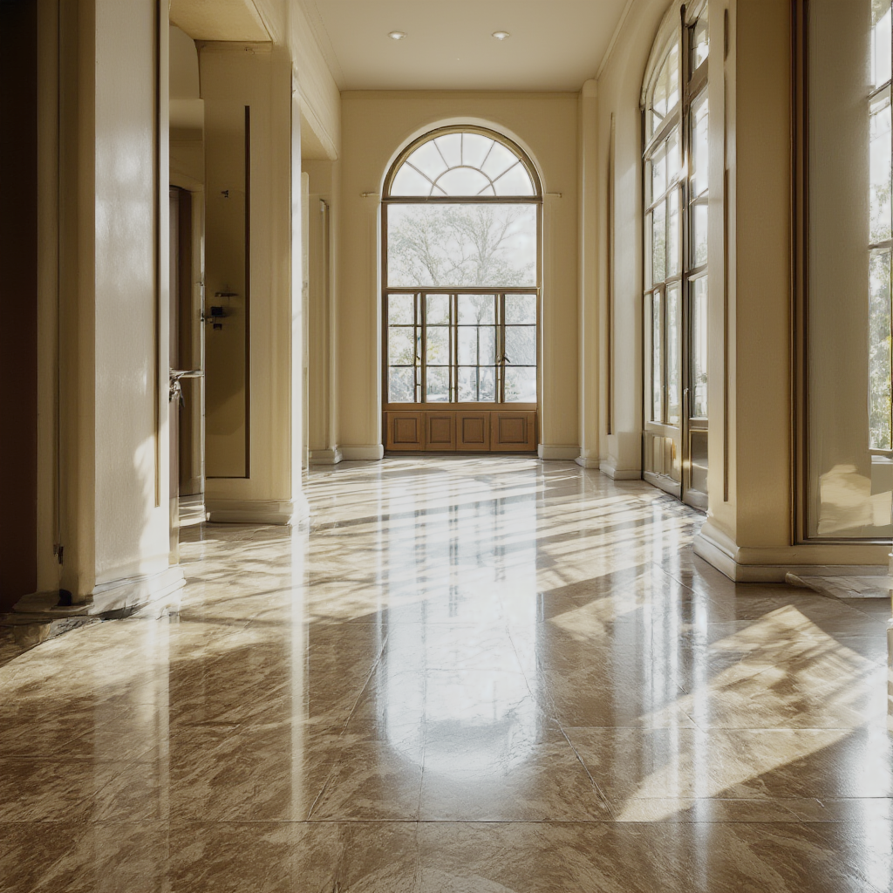
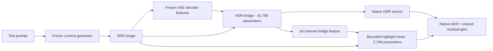

# GainWeave: HDR Image Generation with Frozen Decoder Features and Bounded Residual Gains

[中文](README_zh-CN.md) · [Model weights](https://huggingface.co/Noel2211/GainWeave) · [Method](docs/method.md) · [Training](docs/training.md) · [Results](docs/results.md)

GainWeave recovers relative linear HDR from an SDR image using frozen VAE decoder features. A 42,788-parameter bridge predicts an HDR anchor, and a 2,769-parameter highlight head applies a continuous, RGB-shared correction bounded by ±0.5 EV. The same recovery module can follow Lumina-Image 2.0 to generate HDR images from text.

Version **0.1.0** contains **45,557 learned parameters** in two small weight files. The VAE and text-to-image generator remain separate upstream dependencies. The default presentation uses **+1 EV**, while the native EXR retains the model's unscaled output.



This self-generated example is a display preview. The downloadable model writes a separate float32 HDR EXR.



## Installation

The reference environment is Python 3.12, PyTorch 2.8.0 with CUDA 12.8, Diffusers 0.35.2, Transformers 4.53.3, and NumPy 1.26.4. CUDA recovery uses the VAE and learned modules in FP32. Text generation uses BF16 and then transfers the generated SDR image to the FP32 recovery path.

```bash
# The repository is private during submission preparation; use your authorized GitHub account.
git clone https://github.com/913886605/GainWeave.git
cd GainWeave
python3.12 -m venv .venv
source .venv/bin/activate
python -m pip install --upgrade pip
python -m pip install torch==2.8.0 --index-url https://download.pytorch.org/whl/cu128
python -m pip install -e '.[train,dev]'
```

OpenCV provides float32 ZIP-compressed EXR I/O through the package's image utilities. The package enables its EXR codec; a separate OpenEXR Python dependency is unnecessary.

## Download models

While the model repository is private, first authenticate with an account that has read access:

```bash
hf auth login
```

Reading models needs read permission. Upload permission is used only by the release maintainer.

```bash
gainweave download --task recover
```

Recovery downloads `bridge.safetensors`, `highlight.safetensors`, and the VAE subfolder from the pinned official Lumina repository. It does not require the full FLUX pipeline. Text generation additionally needs Lumina's generator, text encoder, tokenizer, and scheduler:

```bash
gainweave download --task generate
```

GainWeave weights are pinned to `Noel2211/GainWeave@v0.1.0`. The upstream source is `Alpha-VLLM/Lumina-Image-2.0@53504abd8178b30685b6c4c7a4cd181ff78b73e9`. The [component notes](docs/third_party.md) describe its Lumina, Gemma, and FLUX-derived VAE terms. Each user obtains upstream assets under the applicable terms.

## SDR-to-HDR recovery

```bash
gainweave recover \
  --input examples/input.png \
  --output outputs/example \
  --variant gainweave \
  --presentation-ev 1
```

Use `--variant anchor` for the frozen bridge or `--variant fixed` for the fixed mild enhancement `H0 × 2^(0.25w)`. The learned `gainweave` variant applies `H0 × 2^delta`, where `delta = 0.5w tanh(z)`.

The reference recovery size is 1024 × 1024. Compatible sizes are padded to the VAE grid by the implementation; the reported validation uses 1024 × 1024. See [the method and input contract](docs/method.md).

Every recovery saves:

| File | Meaning |
|---|---|
| `native.exr` | Unscaled float32 linear RGB model output |
| `presentation_plus1ev.exr` | Explicit presentation derivative: `2 × native` at the default +1 EV |
| `preview.png` | Selected exposure applied once to native HDR, then RGB Reinhard and exact sRGB |
| `metadata.json` | Model identities, variant, input/output shape, and presentation settings |

`gain.npz` also stores the local EV correction and highlight weight; text generation additionally saves `input_sdr.png`. Selecting another `--presentation-ev` changes the marked presentation EXR name and preview exposure together.

The HDR values are relative. Their physical radiometric units and display luminance in nits are unresolved. A different EXR viewer may use a different display transform; the preview formula is documented in [the output contract](docs/method.md#output-and-display).

## Text-to-HDR generation

```bash
gainweave generate \
  --prompt "A sunlit living room with a white plaster wall and wooden furniture." \
  --seed 0 \
  --output outputs/generated
```

Defaults are 1024 × 1024, 50 sampling steps, guidance 4.0, CFG truncation ratio 0.25, and BF16 generation. The generator first produces an SDR image, then the released FP32 VAE, bridge, and highlight head recover HDR. Automatic CPU offload supports the generation loading path; runtime and memory depend on hardware and offload settings.

## Python API

```python
from pathlib import Path
from gainweave import GainWeave
from gainweave.io import write_exr

model = GainWeave.from_pretrained(
    "Noel2211/GainWeave",
    revision="v0.1.0",
    device="cuda",
    local_files_only=False,
)
result = model.recover("examples/input.png", variant="gainweave")
Path("outputs/python").mkdir(parents=True, exist_ok=True)
write_exr("outputs/python/native.exr", result["hdr_linear_rgb"])
```

For offline recovery, download the assets in advance, pass a local `--model` directory, set `--vae-source` to the local VAE directory, and add `--local-files-only`. The Python API accepts the same `vae_source` and `local_files_only` options. `--revision` selects the GainWeave model revision.

## Prepare data, train, and evaluate

Supply your own licensed linear HDR images and a `dataset.json` description. Preparation computes the exposure anchor and creates a source-aware manifest without silently resizing images.

```bash
gainweave prepare-data --input-root /path/to/licensed_hdr --output-root /path/to/prepared
gainweave train --config configs/train_smooth.yaml --data-root /path/to/prepared
gainweave evaluate --config configs/evaluate.yaml
```

[Data schema](docs/data.md) documents the input and paired evaluation manifests. [Training](docs/training.md) records the original R3-B recipe and the released 2,048-update highlight-head recipe. Training and evaluation use explicit inputs supplied by the user; research datasets and private annotations are outside this release.

## Results

On the fixed development set of 218 sources, 867 views, and five exposures per view, the learned head reduces hard-clip full-image log1p MAE from **0.033665** for the fixed mild enhancement to **0.029331**, while bright-region MAE changes from **0.654013** to **0.661675**. On soft-compressed inputs, the corresponding full-image MAEs are **0.103860** and **0.104051**. The fixed enhancement and learned head were visually close in the inspected generated examples.

The author accepted +1 EV for overall presentation. This is an overall author assessment, separate from independent human scoring. Generated examples have no paired HDR reference. [Results and interpretation](docs/results.md) includes all four native versions, both input mappings, and the recovery/presentation tradeoffs.

## License and release scope

The original code and exported GainWeave parameter files use [Apache-2.0](LICENSE). Upstream models retain their separate terms; [third-party notes](docs/third_party.md) identify the required sources. Training-data weight-release scope remains recorded as an open item in the internal rights ledger. The GitHub and model repositories remain private during submission preparation; the author controls their later visibility.

## Citation

This is a software citation. Noel2211 and GitHub user `913886605` identify the same author.

```bibtex
@software{gainweave_2026,
  author = {Noel2211},
  title = {GainWeave: HDR Image Generation with Frozen Decoder Features and Bounded Residual Gains},
  year = {2026},
  version = {0.1.0},
  url = {https://github.com/913886605/GainWeave}
}
```

## Acknowledgments

GainWeave uses the [Lumina-Image 2.0](https://github.com/Alpha-VLLM/Lumina-Image-2.0) VAE and optional text-to-image pipeline, [Diffusers](https://github.com/huggingface/diffusers), and [PyTorch](https://pytorch.org/). Dataset citations and component conditions are collected in [third-party notes](docs/third_party.md).
