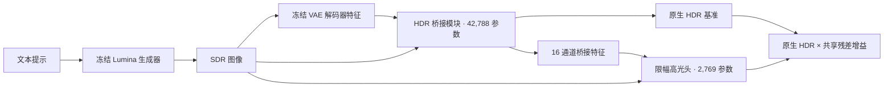

# GainWeave: HDR Image Generation with Frozen Decoder Features and Bounded Residual Gains

[English](README.md) · [模型权重](https://huggingface.co/Noel2211/GainWeave) · [方法](docs/method.md) · [训练](docs/training.md) · [结果](docs/results.md)

GainWeave 使用冻结 VAE 的解码器特征，从 SDR 图像恢复相对线性 HDR。42,788 参数的桥接模块预测 HDR 基准，2,769 参数的高光头再施加连续、RGB 共享、范围受限的局部残差增益。将相同恢复模块接在 Lumina-Image 2.0 后，即可从文本生成 HDR 图像。

**0.1.0** 版本的两个小权重文件共包含 **45,557 个自训参数**。VAE 与文本生成模型由上游单独提供。默认整体呈现使用 **+1 EV**；原生 EXR 保留模型输出，不预乘曝光。



## 安装

参考环境为 Python 3.12、PyTorch 2.8.0/CUDA 12.8、Diffusers 0.35.2、Transformers 4.53.3 与 NumPy 1.26.4。HDR 恢复阶段的 VAE 和自训模块使用 FP32；文本生成使用 BF16，生成 SDR 后进入同一 FP32 恢复路径。

```bash
# 投稿准备期间仓库保持私有，使用已获得访问权的 GitHub 账号。
git clone https://github.com/913886605/GainWeave.git
cd GainWeave
python3.12 -m venv .venv
source .venv/bin/activate
python -m pip install --upgrade pip
python -m pip install torch==2.8.0 --index-url https://download.pytorch.org/whl/cu128
python -m pip install -e '.[train,dev]'
```

图像工具通过 OpenCV 读写 float32、ZIP 无损压缩 EXR。软件会启用对应 EXR codec，无需额外安装 OpenEXR Python 包。

## 下载模型

```bash
gainweave download --task recover
```

恢复任务下载 `bridge.safetensors`、`highlight.safetensors`，以及固定版本官方 Lumina 仓库的 `vae/` 子目录。它不需要完整 FLUX 管线。文本生成还需要 Lumina 生成器、文本编码器、tokenizer 与 scheduler：

```bash
gainweave download --task generate
```

自训权重固定为 `Noel2211/GainWeave@v0.1.0`。上游固定为 `Alpha-VLLM/Lumina-Image-2.0@53504abd8178b30685b6c4c7a4cd181ff78b73e9`。[组件说明](docs/third_party.md)列出 Lumina、Gemma 与 FLUX 来源 VAE 的独立条款；使用者按相应条款获取上游资产。

私有模型仓库需要有读取权限的账号登录：

```bash
hf auth login
```

下载模型使用读取权限；上传权限由发布维护者使用。

## SDR 转 HDR

```bash
gainweave recover \
  --input examples/input.png \
  --output outputs/example \
  --variant gainweave \
  --presentation-ev 1
```

`--variant anchor` 使用冻结桥接基准；`--variant fixed` 使用固定温和增强 `H0 × 2^(0.25w)`；`gainweave` 使用 `H0 × 2^delta`，其中 `delta = 0.5w tanh(z)`。

参考恢复尺寸为 1024 × 1024。兼容尺寸会按 VAE 网格补边，再裁回原尺寸；已报告的验证使用 1024 × 1024。详细输入约定见[方法说明](docs/method.md)。

每次恢复保存：

| 文件 | 含义 |
|---|---|
| `native.exr` | 未预乘曝光的 float32 线性 RGB 原生输出 |
| `presentation_plus1ev.exr` | 明确标记的 +1 EV 呈现派生文件，默认值为 `2 × native` |
| `preview.png` | 在原生 HDR 上施加一次所选曝光，再经 RGB Reinhard 与 exact sRGB 映射 |
| `metadata.json` | 模型身份、方法、输入输出尺寸及呈现设置 |

`gain.npz` 另存局部 EV 修正与高光权重；文本生成还会保存 `input_sdr.png`。修改 `--presentation-ev` 时，明确标记的呈现 EXR 文件名和预览曝光随之变化。

HDR 数值采用相对尺度，物理辐射单位与显示器 nits 尚未标定。EXR 查看器可使用不同的曝光、色调映射与色彩管理设置；本软件的预览公式见[输出约定](docs/method.md#output-and-display)。

## 文本生成 HDR

```bash
gainweave generate \
  --prompt "A sunlit living room with a white plaster wall and wooden furniture." \
  --seed 0 \
  --output outputs/generated
```

默认尺寸为 1024 × 1024，50 步，guidance 4.0，CFG truncation ratio 0.25，生成精度为 BF16。Lumina 先生成 SDR，再由发布的 FP32 恢复模块输出 HDR。`--offload auto` 按设备显存选择生成模型的放置方式，也可设为 `none`、`model` 或 `sequential`；耗时与内存取决于硬件及该设置。

## Python API

```python
from pathlib import Path
from gainweave import GainWeave
from gainweave.io import write_exr

model = GainWeave.from_pretrained(
    "Noel2211/GainWeave",
    revision="v0.1.0",
    device="cuda",
    local_files_only=False,
)
result = model.recover("examples/input.png", variant="gainweave")
Path("outputs/python").mkdir(parents=True, exist_ok=True)
write_exr("outputs/python/native.exr", result["hdr_linear_rgb"])
```

离线使用时，提前下载权重，用 `--model` 指定本地 GainWeave 目录，用 `--vae-source` 指定本地 VAE 目录，并添加 `--local-files-only`。Python API 同样接受 `vae_source` 与 `local_files_only`。`--revision` 选择 GainWeave 权重版本。

## 数据准备、训练与评价

提供有使用权的线性 HDR 图像及 `dataset.json`。准备工具计算曝光基准，生成按来源划分的清单，保持输入几何尺寸。

```bash
gainweave prepare-data --input-root /path/to/licensed_hdr --output-root /path/to/prepared
gainweave train --config configs/train_smooth.yaml --data-root /path/to/prepared
gainweave evaluate --config configs/evaluate.yaml
```

[数据格式](docs/data.md)给出输入与配对评价清单。[训练说明](docs/training.md)记录原始 R3-B 配方及最终高光头的 2,048 次更新配方。训练与评价读取使用者明确提供的数据；研究数据集和私有标注不包含在发布包内。

## 结果

固定开发集包含 218 个来源、867 个视角，每个视角有五档曝光。硬裁剪输入下，学习头相对固定温和增强将全图 log1p MAE 从 **0.033665** 降至 **0.029331**，参考亮部 MAE 从 **0.654013** 变为 **0.661675**。软压缩输入下，两者全图 MAE 分别为 **0.103860** 和 **0.104051**。实际查看的生成图中，固定增强与学习头观感接近。

作者接受 +1 EV 作为整体呈现设置。这是作者整体审阅意见，与独立人工评分分开记录；生成图没有配对 HDR 真值。[结果说明](docs/results.md)保留四个原生版本、两类输入及恢复与呈现之间的取舍。

## 许可与发布范围

原创代码和导出的 GainWeave 参数文件采用 [Apache-2.0](LICENSE)。上游模型保留各自条款，见[第三方说明](docs/third_party.md)。训练数据所涉及的权重发布范围仍作为待补项保留在内部统一权利台账中。投稿准备期间，GitHub 与模型仓库均保持私有，后续可见性由作者决定。

## 引用

以下是软件引用。Noel2211 与 GitHub 用户 `913886605` 为同一作者。

```bibtex
@software{gainweave_2026,
  author = {Noel2211},
  title = {GainWeave: HDR Image Generation with Frozen Decoder Features and Bounded Residual Gains},
  year = {2026},
  version = {0.1.0},
  url = {https://github.com/913886605/GainWeave}
}
```

## 致谢

GainWeave 使用 [Lumina-Image 2.0](https://github.com/Alpha-VLLM/Lumina-Image-2.0) 的 VAE 与可选文本生成管线，以及 [Diffusers](https://github.com/huggingface/diffusers) 和 [PyTorch](https://pytorch.org/)。数据集引用与组件条件见[第三方说明](docs/third_party.md)。
